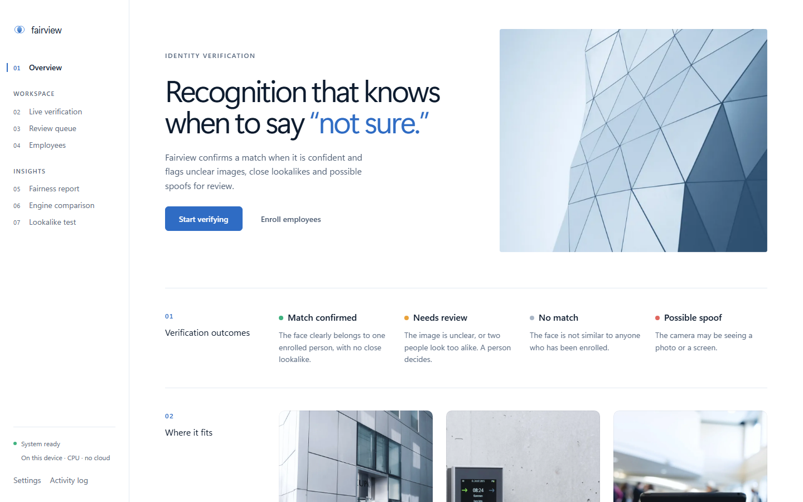
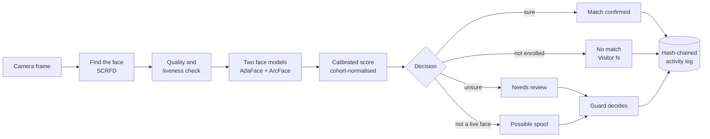
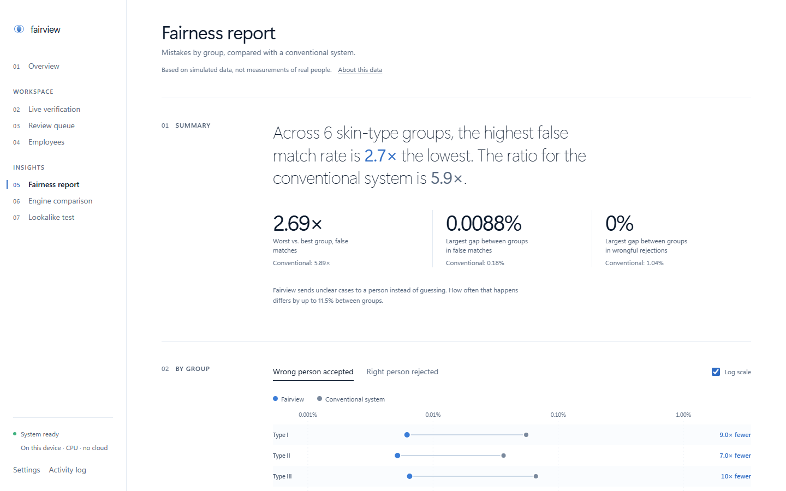
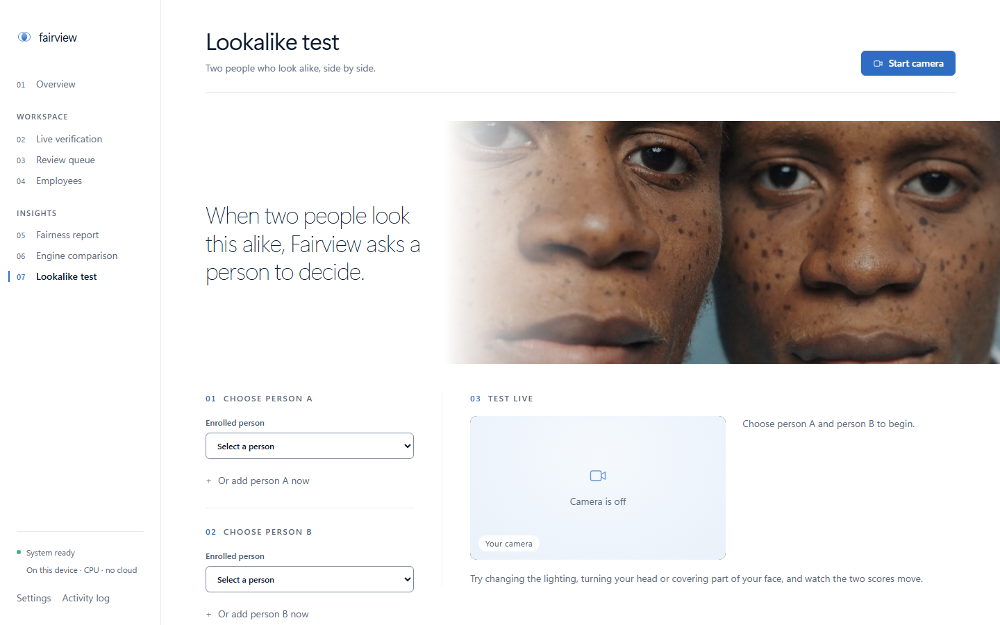

# Fairview

Face recognition for building access that is allowed to say **"I'm not sure."**

Most face recognition systems always give an answer: the closest match wins.
That goes wrong when two people look alike, when the lighting is bad, or when
the model is simply less accurate for some groups of people than others. A
forced answer in those cases is a wrongful identification.

Fairview confirms a match only when it is confident, and sends every unsure
case to a person. Every face gets one of four outcomes:

| Outcome | When | What happens |
|---|---|---|
| **Match confirmed** | The face clearly belongs to one enrolled person | Let through, by name |
| **Needs review** | Unclear image, a lookalike, or a borderline score | Sent to a guard, with the photo |
| **No match** | Not enrolled | Treated as a visitor, not a suspect ("Visitor 1") |
| **Possible spoof** | A photo or screen held up to the camera | Flagged and sent to a guard |

It runs entirely on the device (a normal laptop with a webcam, CPU only, no
cloud) and shows everything in a browser dashboard.

> **2nd place, NC A&T Hackathon, Lenovo problem statement.** Built by
> CTRL ALT Elite: Yousif, Dev, Adam and Abdulrahman.



## Run it

You need **Python 3.10+**, a webcam, about 1 GB of disk space and internet on
the first start (about 115 MB of model weights are downloaded once).

```bash
git clone https://github.com/fukubie/fairview.git
cd fairview
python3 run.py          # Windows: py run.py
```

Open **http://localhost:8000** when the terminal says so, and allow camera
access.

The first start takes a few minutes: `run.py` creates a private `.venv/`,
installs the dependencies, downloads the models and checks each one against a
pinned SHA-256. Later starts take seconds. Stop with `Ctrl+C`.

**Try it:** press *Start camera*, type a name, press *Capture and enroll* and
turn your head slightly while it takes 3 to 5 frames. Look at the camera again
and you should be boxed as a match. Cover part of the lens or dim the lights to
see it say "uncertain" instead of guessing.

Useful options:

| Command | What it does |
|---|---|
| `python3 run.py --port 8080` | Use another port. |
| `python3 run.py --https` | Self-signed HTTPS on your network, so a phone can join a call room. Prints an API key to enter in the dashboard. |
| `python3 run.py --offline` | Never download; use models already in `models/`. |
| `python3 run.py --check` | Check dependencies and models, then exit. |

To start over, delete the `data/` folder (enrolled people, audit log, key).

## Deploy it

| Where | How |
|---|---|
| **Docker on this machine** | `docker compose up --build`. Locked-down container (read-only, unprivileged), published on loopback only. |
| **Your own domain** | [`deploy/server/`](deploy/server/): Fairview behind [Caddy](https://caddyserver.com), which gets and renews the HTTPS certificate browsers need for the camera. On a fresh Ubuntu 24.04 server (2 GB+ RAM) with the domain's `@` and `www` A records pointing at it: `sudo bash deploy/server/setup.sh your-domain.com`. Run it again to update. |
| **Hugging Face Space** | `python deploy/huggingface/build_space.py --upload YOUR_NAME/fairview` after `huggingface-cli login`. Builds from git-tracked files only (no faces, logs, keys or models). Docker Spaces need Hugging Face PRO, and the free storage is wiped on every restart. See [`deploy/huggingface/`](deploy/huggingface/). |

Both public deployments are set up as **short-lived demos**: they set
`FAIRFACE_OPEN_ACCESS=1`, so anyone with the address can use the dashboard
without a key. Set `FAIRFACE_API_KEY` to require one. On the Space,
`FAIRFACE_FRAME_ANCESTORS=https://huggingface.co` lets the Space page show the
dashboard in a frame; otherwise the app never allows framing.

## How it works



1. **Detect and align.** SCRFD finds each face and its 5 landmarks; the face
   is aligned to 112×112.
2. **Liveness.** Two MiniFASNet models check it is a real face, not a photo or
   screen.
3. **Embed and measure quality.** AdaFace and ArcFace each turn the face into
   a 512-number vector. AdaFace's vector length doubles as an image-quality
   score, and the two vectors are combined, weighted by that quality.
4. **Calibrate.** The score is compared against a fixed "cohort" of reference
   faces so it means the same thing for everyone (see below).
5. **Decide**, and write the result to a tamper-evident log.

**The decision rules**, checked in order (first one that applies wins):

1. Liveness too low → *spoof detected*.
2. Image quality too low → *uncertain* (bad picture, don't guess).
3. Best score below the low threshold → *no match*.
4. Best score above the high threshold, but the runner-up is close behind →
   *uncertain* (two lookalikes, don't pick one).
5. Best score above the high threshold and the person was fully enrolled →
   *match*.
6. Anything in between → *uncertain*.

Default thresholds are in `backend/config.py` and can be changed live in the
dashboard.

**Why it is fairer.** Nothing in the system guesses anyone's race or skin tone,
and everyone gets the same thresholds. The fairness comes from three things:

- **Cohort calibration.** Raw similarity scores run higher for people whose
  faces sit in a "crowded" part of the model's space, and how crowded it is
  differs between demographic groups. Each score is compared to how that face
  scores against 100 similar-looking strangers, which evens this out.
- **Thresholds set by the worst-off group.** When the thresholds were chosen
  offline, they were tuned so the group with the *most* false matches still
  stays under the target rate.
- **Abstaining.** Bad images and close calls go to a person instead of being
  guessed.

**Results.** Both are on synthetic data, not measurements of real people.

- *Held-out generated faces, 7 groups, the real shipped models*
  (`backend/assets/calibration_report.json`): with a plain global
  normalisation the false-match rate differed between groups by up to
  **151×**; with cohort calibration the gap was **2.8×**, and every group was
  at or under target at the 1-in-1,000 operating point.
- *Simulated six-group skin-type benchmark* (Fairness report tab): the
  worst-served group is falsely matched **2.7×** as often as the best-served
  one with Fairview, against **5.9×** for a conventional one-threshold system.

| | |
|---|---|
| **Built and working** | Face pipeline, review queue with photos, banned-list alerts, visitor numbers, five-day onboarding, activity log, engine comparison, phone call room |
| **Simulated** | The skin-type fairness numbers above, the lookalike stress test |
| **Next** | NPU acceleration, access control for critical zones, a real-data fairness benchmark, a pilot |

### What else is in the dashboard

- **Live camera** with boxes and badges per face, plus a **call room**: a phone
  scans a QR code and its camera is analysed too (peer-to-peer WebRTC, video
  only).
- **Review queue**: uncertain and spoof results become one case per visit,
  with the clearest frames, for a person to decide.
- **Banned list**: a site can flag enrolled people; a sighting opens a review
  case and is drawn in red. It never triggers anything automatically.
- **Visitors**: un-enrolled faces get a temporary label ("Visitor 3") held in
  memory only, never saved.
- **Employee onboarding**: check-ins on separate days build up a stronger
  template.
- **Lookalike stress test**, **baseline vs. Fairview** side-by-side, a
  **fairness audit** with per-group charts and threshold sliders, and the
  **audit log** with export.

| Fairness report | Lookalike test |
|---|---|
|  |  |

**Optional real-data section (RFW).** The Fairness report can also show how a
conventional system does on published Racial Faces in the Wild pair scores.
That data belongs to the FaVFA project (CeCILL 2.1) and is not included here.
To enable it, put a FaVFA checkout at `FaVFA-main/` inside this folder
(git-ignored) or next to it, or point `FAIRFACE_RFW_DIR` at one. It needs
`data/rfw.csv` and `model_results/BUPT_RFW.csv`. Without it the section is
simply hidden.

### Privacy and security

- Video and photos are analysed in memory and dropped. The only images kept
  are the face crop behind an *open* review case (deleted when decided, or
  after 24 h) and an optional photo on a banned-list record.
- Face templates are encrypted at rest (AES-256-GCM) in `data/biometrics.db`.
  The key is generated into `data/biometric.key`, or set
  `BIOMETRIC_ENCRYPTION_KEY` to supply your own.
- Every decision and admin action is written to a SHA-256 hash chain, so
  edits to the log can be detected.
- The server listens on this machine only by default. On a network it
  requires an API key, checks the `Host` and origin of every request, and
  limits upload sizes.

## Project layout

```
run.py                  one-command launcher (venv, dependencies, models, server)
backend/
  main.py               FastAPI app: REST API, camera WebSocket, call-room signalling
  config.py             thresholds and settings (all overridable by FAIRFACE_* env vars)
  security.py           request guard: host, origin, API key, body size
  camera.py             optional server-side USB/RTSP camera
  engine/               detector, liveness, embedder, calibrator, decision, pipeline,
                        visitors, model_manager (download + SHA-256 check)
  storage/              vault (encrypted templates), audit (hash chain), review queue
  fairness/audit.py     fairness metrics and simulations for the dashboard
  assets/               calibration data: reference embeddings (no images) and thresholds
frontend/               plain HTML/CSS/JS dashboard, no build step, no CDN
tools/build_calibration.py   rebuilds backend/assets from your own labelled data
tests/                  pytest suite
deploy/server/          Docker + Caddy setup for your own domain
deploy/huggingface/     Hugging Face Space build and upload script
docs/                   README screenshots and the hackathon pitch script
```

Full API reference is served at **/api/docs** while the app runs. Every
setting in `backend/config.py` can be overridden with a `FAIRFACE_*`
environment variable; the most useful are `FAIRFACE_API_KEY`,
`FAIRFACE_TAU_HIGH` / `_TAU_LOW` / `_MARGIN` (thresholds),
`FAIRFACE_LIVENESS=0` (skip anti-spoofing), `FAIRFACE_PUBLIC_URL`,
`FAIRFACE_ICE_SERVERS` (TURN), `FAIRFACE_OPEN_ACCESS`,
`FAIRFACE_FRAME_ANCESTORS` and `FAIRFACE_RFW_DIR`.

## Tests

```bash
pip install -r requirements-dev.txt
pytest tests/
```

Most tests run the real pipeline, storage and audit log with stand-ins for the
neural networks, so no weights are needed. On Windows, two tests that check
Unix file permissions (`chmod 0600`) fail because NTFS doesn't support them.

## Limitations

Read these before trusting it with anything real.

- **Research prototype, not a certified product.** Don't use it as the only
  thing deciding who gets in.
- **Default models are non-commercial.** Three of the five downloaded models
  are licensed for research only. Commercial use needs your own licensed
  weights (`FAIRFACE_MODEL_DETECTOR`, `_ARCFACE`, `_ADAFACE`) and a rebuilt
  calibration. See [ATTRIBUTIONS.md](ATTRIBUTIONS.md).
- **Calibrated on synthetic faces.** The fairness numbers come from generated
  faces whose group labels are the generator's race/ethnicity labels, **not
  skin tone**. Real cameras and real people may behave differently. Recalibrate
  on consented data from your own population with `tools/build_calibration.py`.
- **An un-enrolled lookalike can still pass.** The "close runner-up" rule only
  works if both people are enrolled. If only the double is enrolled, a similar
  enough face can be accepted.
- **Abstaining has a cost.** If a camera handles darker skin worse, more of
  those people get sent to manual review. The fairness tab shows abstention
  rates per group for this reason.
- **Liveness is a deterrent, not a guarantee.** Single-frame anti-spoofing can
  be fooled by unfamiliar screens, prints or masks.
- **Speed.** About 6 analysed frames per second for one face on a 2-core CPU,
  slower with more faces. The video preview itself stays smooth.
- **Phones need HTTPS** to use the camera, and the call room uses Google's
  public STUN server, which can't get through every network (add a TURN server
  via `FAIRFACE_ICE_SERVERS`).
- **Open-access demos are open.** With `FAIRFACE_OPEN_ACCESS=1` (the default
  in both public deployments) anyone with the address can enroll faces and
  read the log. Take demos down afterwards or set an API key.
- **Single process.** Run one server per `data/` folder.
- **The audit log can't detect deletion of its newest entries** on its own;
  `GET /api/audit` returns the latest hash so you can store it elsewhere.

## Credits and licences

Full provenance (what was taken from where, file by file, with hashes) is in
[ATTRIBUTIONS.md](ATTRIBUTIONS.md). No third-party source code is included in
this repository, and model weights are downloaded from their original
publishers, not redistributed here.

**Models** (downloaded at first start from mirrors on [Hugging Face `immich-app/buffalo_s`](https://huggingface.co/immich-app/buffalo_s) and [yakhyo](https://github.com/yakhyo)'s GitHub releases; exact URLs and hashes in `backend/engine/model_manager.py`)

| Model | Source | Licence |
|---|---|---|
| SCRFD-500M face detector | [InsightFace](https://github.com/deepinsight/insightface) `buffalo_s` | Non-commercial research only |
| ArcFace MobileFaceNet (WebFace600K) | [InsightFace](https://github.com/deepinsight/insightface) `buffalo_s` | Non-commercial research only |
| AdaFace IR-18 (WebFace4M) | [AdaFace](https://github.com/mk-minchul/AdaFace), ONNX export by [yakhyo/adaface-onnx](https://github.com/yakhyo/adaface-onnx) | Code MIT; weights treated as research only |
| MiniFASNetV2 / V1SE liveness | [Silent-Face-Anti-Spoofing](https://github.com/minivision-ai/Silent-Face-Anti-Spoofing), ONNX export by [yakhyo/face-anti-spoofing](https://github.com/yakhyo/face-anti-spoofing) | Apache-2.0 |

**Calibration data:** [SynthFaces](https://huggingface.co/datasets/shredder67/synthfaces-faces-balanced)
(generated faces, tagged MIT). Only embedding vectors are stored, no images.

**Projects we studied** (ideas and documented behaviour; no code copied):
[InsightFace](https://github.com/deepinsight/insightface) (MIT),
[AdaFace](https://github.com/mk-minchul/AdaFace) (MIT),
[DeepFace](https://github.com/serengil/deepface) (MIT),
[CompreFace](https://github.com/exadel-inc/CompreFace) (Apache-2.0),
[fairlearn](https://github.com/fairlearn/fairlearn) (MIT),
[mllm-fairness](https://github.com/idiap/mllm-fairness) (MIT),
FaVFA, from *Fairer Analysis and Demographically Balanced Face Generation for Fairer Face Verification* (WACV 2025) (CeCILL 2.1),
[facerec-bias-bfw](https://github.com/visionjo/facerec-bias-bfw) (BSD-3-Clause),
[Synthetic-Fairness-Faces](https://github.com/Marco210210/Synthetic-Fairness-Faces) (CC BY-NC-SA 4.0, metric definitions only).
Methods from the literature: Fairness Discrepancy Rate (de Freitas Pereira &
Marcel, 2021) and adaptive symmetric score normalisation (AS-norm).

**Python libraries:** ONNX Runtime (MIT), ONNX (Apache-2.0), NumPy
(BSD-3-Clause), OpenCV (Apache-2.0), FastAPI (MIT), Starlette (BSD-3-Clause),
Uvicorn (BSD-3-Clause), websockets (BSD-3-Clause), python-multipart
(Apache-2.0), cryptography (Apache-2.0 / BSD-3-Clause), qrcode (BSD-3-Clause),
pytest (MIT), httpx (BSD-3-Clause).

**Photography:** all from [Pexels](https://www.pexels.com/license/) (free to
use, credit given anyway), cropped and colour-graded:
Mathias Reding ([glass facade](https://www.pexels.com/photo/a-glass-building-with-geometric-design-12884318/),
[entrance](https://www.pexels.com/photo/entrance-to-modern-building-in-city-10586212/)),
Tima Miroshnichenko ([white facade](https://www.pexels.com/photo/facade-of-a-white-building-against-clear-blue-sky-6010424/)),
Susanne Plank ([access card](https://www.pexels.com/photo/man-hand-holding-access-card-over-reader-13657444/)),
Caleb Oquendo ([tablet](https://www.pexels.com/photo/modern-tablet-device-in-public-space-35985168/)),
Cedric Fauntleroy ([receptionist](https://www.pexels.com/photo/a-receptionist-looking-at-a-tablet-4269266/)),
Jenum ([twins](https://www.pexels.com/photo/close-up-portrait-of-identical-twin-brothers-37844103/)).
Per-file details are in [frontend/assets/CREDITS.md](frontend/assets/CREDITS.md).
The Fairview logo is original artwork.

**Services:** the domain deployment uses [Caddy](https://caddyserver.com)
(Apache-2.0) with Let's Encrypt certificates; call rooms use Google's public
STUN server
(`stun.l.google.com:19302`) to connect peers. No video passes through it.

**Built with** [Claude](https://claude.ai) (Anthropic) as a coding assistant.

## Team

**CTRL ALT Elite**: Yousif ([@yoyoslayer](https://github.com/yoyoslayer)),
Abdulrahman ([@fukubie](https://github.com/fukubie)), Dev and Adam, with Claude
as an AI pair programmer.

## Licence

Fairview's own code is released under the [MIT License](LICENSE). This covers
only the code in this repository. The model weights it downloads keep their
own licences (three of them are non-commercial research only; see
[Credits and licences](#credits-and-licences)), and the photographs are used
under the Pexels License.
